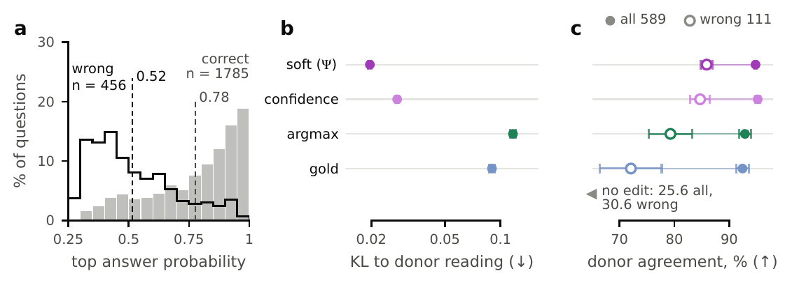
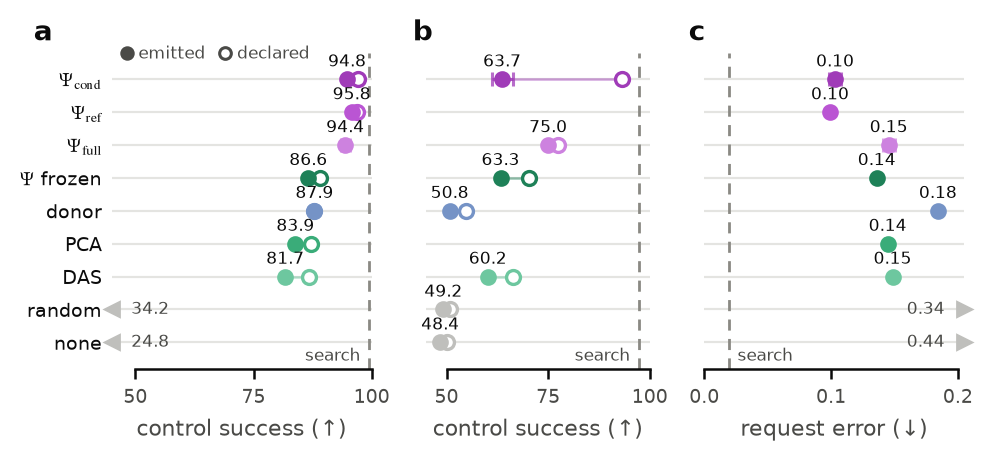

# Ψ: Programmable Semantic Interventions

[](https://arxiv.org/abs/2611.21307)
[](https://adaptivemotorcontrollab.github.io/psi/)
[](https://adaptivemotorcontrollab.github.io/psi/demos/)
[](https://github.com/AdaptiveMotorControlLab/psi/actions/workflows/tests.yml)
[](LICENSE)

Code for **Programmable Semantic Interventions: Learning Causal Carriers from
Behavioral Programs** (Paolo Muratore and Mackenzie Weygandt Mathis, EPFL).

PSI finds where a frozen language model carries a variable: a low-rank subspace
of its activations such that interchanging it between two prompts changes the
model's answer the way the variable says it should. You describe the variable
with a *semantic program*, the list of answers it can produce and which of them
an intervention should yield. The training targets are read from the frozen
model itself, on random prompt pairs, so no counterfactual dataset and no
ground-truth label is needed.


## Install

```bash
pip install "psi[notebooks] @ git+https://github.com/AdaptiveMotorControlLab/psi"
```

Python 3.11 or later and PyTorch 2.9 or later. Models and datasets download
from Hugging Face on first use. For development, clone the repository and run
`pip install -e ".[dev]"`.

## Quick start

```python
import psi

# MIB's multiple-choice task: the variable is which option the model picks.
prompts, program = psi.presets.mcqa(limit=64)
model = psi.PSI("Qwen/Qwen2.5-0.5B", layer=15, rank=16, epochs=8, steering=True,
                batch_size=8, max_length=64)
print(program.check(model, prompts))       # does the model answer within the program?
model.fit(prompts, program)
print(model.score(prompts, split="test"))  # carrier swap against no edit, held out
base, donor = prompts.splits["test"][:2]
print(model.swap(base=base, donor=donor))  # the base's answer before and after
model.save("my-carrier")
restored = psi.PSI.load("my-carrier", device="cpu")
```

On a GPU this takes a few minutes, downloads included. On a CPU, use the demos'
`SMOKE` setting below, which shrinks the run to a size a CPU finishes. The
[quick-start notebook](notebooks/01-quickstart.ipynb) runs the same steps with
plots, and also asks the fitted model for answers without a donor.

## Declaring a variable

A program has two parts: the **answers** the variable can produce, and the
**rule** for what the model should answer after an interchange.

### Answers

There are two kinds, and they mean different things even on the same prompts.

- `psi.Values([" France", " Japan", ...])` gives every prompt the same list.
  The variable's value is the answer itself.
- `psi.Slots("choices.label")` gives each prompt its own options, read from a
  column. The variable's value is the slot: the first option, the second, and so
  on. Every prompt needs the same number of options.

Take a base prompt whose options are labelled `W X Y Z`, where the model
answers `X`, and a donor whose options are `A B C D`, where the model answers
`C`. Under the rule `"copy"`:

| Declaration | The base should now answer |
|---|---|
| `Values([" A", " B", ..., " Z"])`: which letter | `C`, the donor's letter |
| `Slots("choices.label")`: which position | `Y`. The donor chose its third option, and the base's third option is Y |

Answers are used verbatim as continuations of the prompt, so a leading space
usually belongs in them (`" A"`). An answer may span several tokens; it is
scored by its summed log-probability.

### Rules

| Rule | After an interchange the base should |
|---|---|
| `"copy"` | take the donor's value |
| `"keep"` | keep its own answer (a control) |
| `psi.Gated("column")` | copy on prompts where the boolean column is true, keep elsewhere |
| `psi.Table({0: 1, 1: 0})` | answer the slot the table assigns to the donor's slot |

### Prompts

```python
prompts = psi.Prompts(texts, columns={"gold": gold_answers})   # at least six prompts
prompts = psi.Prompts.from_pandas(frame, text="prompt")
prompts = psi.Prompts.from_hf("mib-bench/copycolors_mcqa", "4_answer_choices",
                              text="prompt", options="choices.label", gold="answerKey")
program = psi.Program(psi.Values([" A", " B"]), rule="copy")
```

Splits come from the dataset, or from a seeded 80/10/10 assignment. The site is
the last token by default; `PSI(..., position=psi.At(r"regex"))` reads the last
token of the first match instead. A gold column is optional and only used for
evaluation, the correctness filter or `target="gold"`.

`program.check(model, prompts)` runs before any training. It reports how much
probability the model puts on the declared answers, how often it picks each,
its agreement with gold when there is a gold column, and the mass of the
answers with a leading space added or removed. Low mass means the program does
not match how this model answers.

`psi.scan_layers(model_id, prompts, program, layers=[7, 15, 23])` fits briefly
at each layer and scores the validation split, which is how to choose `layer`.
Score the chosen layer on test afterwards.
[Your own variable](notebooks/02-your-own-variable.ipynb) does this with prompts
written in the notebook.

## What a fitted model does

| Call | Returns |
|---|---|
| `score(prompts, split="test")` | interchange agreement against its no-edit baseline, model agreement, answer mass, and steering success when trained with `steering=True` |
| `swap(base=..., donor=...)` | both prompts' answers, and the base's answer after receiving the donor's carrier |
| `reading(prompt)` | the model's distribution over the program's answers |
| `steer(prompt, answer=...)` | the answer after writing a requested value into the carrier; needs `steering=True` |
| `save(path)`, `PSI.load(path)` | a directory with `psi.json` (model, revision, site, program, settings) and `weights.safetensors` |
| `push_to_hub(repo)`, `PSI.from_pretrained(repo)` | the same directory on the Hugging Face Hub |

Every success rate is an argmax over the declared answers. Interchange agreement
compares with the pair targets and averages counterfactual families equally.
Model agreement applies the rule to the frozen model's own readings; the two
differ where the model's answer differs from gold.

The estimator supports residual-stream sites of causal language models. A
loaded model can be passed directly: `PSI(model, tokenizer=tokenizer, layer=...)`.

## Demos

| Notebook | What it shows | |
|---|---|---|
| [Learn a carrier, swap it and steer it](notebooks/01-quickstart.ipynb) | an option-position variable on Qwen2.5-0.5B: check, fit, score, donor swaps and requested answers | [](https://colab.research.google.com/github/AdaptiveMotorControlLab/psi/blob/main/notebooks/01-quickstart.ipynb) |
| [Declare a letter-copy variable](notebooks/02-your-own-variable.ipynb) | prompts generated in Python, an answer-mass check and a layer scan | [](https://colab.research.google.com/github/AdaptiveMotorControlLab/psi/blob/main/notebooks/02-your-own-variable.ipynb) |

Each notebook installs the package, downloads what it needs, and ships with
the outputs of a full run. Setting `SMOKE = True` in its configuration cell gives a
small run that finishes on a CPU. The rendered notebooks are on the
[project page](https://adaptivemotorcontrollab.github.io/psi/demos/).

## Results

All numbers are from the paper: Gemma-2 2B, residual stream at layer 17, last
token, rank-16 subspace, on the [MIB benchmark](https://huggingface.co/mib-bench)
and on natural ARC science questions.

- **On par with supervised alignment.** At matched data and training budget on
  MIB's multiple-choice task, PSI reaches a MIB score of 90.24 ± 0.52 on random
  pairs, against 91.70 ± 0.93 for DAS trained on the benchmark's curated pairs.
  On 122 test pairs the gap is one or two pairs.
- **No labels at any stage.** Removing the correctness filter, so that no gold
  label selects prompts, sets targets or picks checkpoints, costs 0.9 points.
- **Tracks the model where it is wrong.** On 2241 natural ARC questions,
  unfiltered, the subspace makes the recipient give the donor's answer in 85.9%
  of pairs whose donor the model answers wrongly, against 72.1% for a subspace
  trained on gold labels.



- **The subspace carries the variable.** Trained with uppercase option letters
  and tested with the options relabelled, it writes the donor's *position* in
  the recipient's own symbols: from a lowercase donor into an uppercase
  recipient, it transfers the position in 100% of pairs and outputs the donor's
  own symbol in none.


- **Steering without a donor.** Because the program fixes what each coordinate
  means, a controller trained jointly with the subspace realizes 94.8% of
  held-out requests for a chosen answer, with no donor prompt.



## Command line

The paper's runs use YAML configs and the `psi-train` command:

```bash
psi-train configs/mcqa-qwen2.5-0.5b.yaml
```

This trains a rank-16 subspace for the position of the correct option in MIB's
multiple-choice task, on Qwen2.5-0.5B. The first run downloads the model and
the dataset, reads the frozen model on every prompt and caches its activations
under `data/`; later runs with the same model and site reuse that cache. Each
run writes to `runs/manual/<timestamp>/`:

| File | Content |
|---|---|
| `resolved.yaml` | the configuration as run |
| `metrics.csv` | training and validation metrics |
| `checkpoints/best.ckpt` | the selected checkpoint |
| `data_controls.json` | the pairing and pool settings the data module applied |

Options: `--seed N` replaces every field named `seed`, `--set path=value`
overrides any field (`--set cut.layer=12`), `--run-dir` chooses the output
directory, and `--dry-run` prepares the task and runs a single training and
validation batch without creating a run directory.

The other configs reproduce the paper's settings on Gemma-2 2B, which is a
gated model: accept its license on Hugging Face and log in
(`huggingface-cli login`) before the first run.

| Config | Setting |
|---|---|
| `configs/mcqa-qwen2.5-0.5b.yaml` | MIB multiple choice, Qwen2.5-0.5B, layer 15 |
| `configs/mcqa-gemma-2-2b.yaml` | MIB multiple choice, Gemma-2 2B, layer 17 (paper, Section 3.1) |
| `configs/arc-gemma-2-2b.yaml` | natural ARC questions, unfiltered, 768 updates (paper, Section 3.2) |

A program can also be declared in a config, with `data.task: program`:

```yaml
data:
  task: program
  dataset: mib-bench/copycolors_mcqa
  subset: 4_answer_choices
  text: prompt
  answers: {slots: choices.label}      # or {values: [" A", " B"]}
  rule: copy
  gold: answerKey
  max_length: 64
  cache_root: data/psi
  batch_size: 8
  num_workers: 0
```

This route uses the column's strings exactly as stored; the Python preset
`psi.presets.mcqa` adds the leading spaces the paper's program uses.

## Configuration

A config has one block per part of the method.

| Block | What it sets |
|---|---|
| `subject` | the frozen model (`model`, a Hugging Face id), `device`, `dtype` |
| `cut` | the site: `kind: residual`, `layer`, and `position`, one of the task's named token positions |
| `data` | the task and its variable, the dataset, the prompt pairing and batch sizes |
| `psi` | the semantic program's size (`test_dim`), the subspace and the objective |
| `trainer`, `checkpoint` | passed to PyTorch Lightning's `Trainer` and `ModelCheckpoint` |

Fields of `psi` you are most likely to change:

| Field | Values |
|---|---|
| `test_dim` | number of answers in the program; inferred from the task when omitted |
| `abstraction.carrier_rank` | rank of the subspace |
| `abstraction.activation_dim` | hidden size of the model at the cut; inferred from the model when omitted |
| `target_kind` | `soft`, the model's distribution over the answers (PSI); `hard`, its argmax; `gold`, the dataset's label |
| `objective.mass_mode` | `full`, `conditional` or `reference`: how the loss treats probability mass outside the declared answers |
| `transport` | the program's rule for the answer after an interchange: `full_change` takes the donor's, `no_change` keeps the recipient's, `gated_change` and `table` choose per pair from a gate the task provides |
| `loss_weights` | `donor`, `nuisance`, `calibration` and `control` terms of the objective |

Fields of `data`: `correctness_filter: false` trains on every prompt instead of
those the model answers correctly; `donor_pairing` is `derangement` (a random
donor for each prompt) or `curated` (the dataset's own counterfactual pairs).

## Built-in tasks

| `data.task` | Variables | Positions |
|---|---|---|
| `program` | declared in the config | `last_token` by default |
| `mcqa` | `x_order`, `o_answer` | `last_token`, `correct_symbol`, `correct_symbol_period` |
| `arc` | `x_order`, `o_answer` | `last_token`, `correct_symbol` |
| `arithmetic` | `x_carry` | `op2_last`, `last` |
| `ravel` | `a_country`, `a_continent`, `a_language` | `last_token`, `entity_last_token` |
| `ioi` | `output_position`, `output_token` | `all` |

A task with its own preparation is a subclass of `TaskPreparation`
(`psi/data/task.py`) that implements `_prepare_input`, `_prepare_activations`
and `_prepare_outcomes`. `psi/data/tasks/arc.py` is the smallest example and
`psi/data/tasks/mcqa.py` a complete one. Most new variables need only `Prompts`
and `Program`.

## Tests

```bash
pip install -e ".[dev]"
pytest
```

The tests run on CPU and download nothing.

## Citation

```bibtex
@article{muratore2026programmable,
  title   = {Programmable Semantic Interventions: Learning Causal Carriers from Behavioral Programs},
  author  = {Muratore, Paolo and Mathis, Mackenzie Weygandt},
  journal = {arXiv preprint arXiv:2611.21307},
  year    = {2026}
}
```

## License

Apache-2.0, see [LICENSE](LICENSE).
