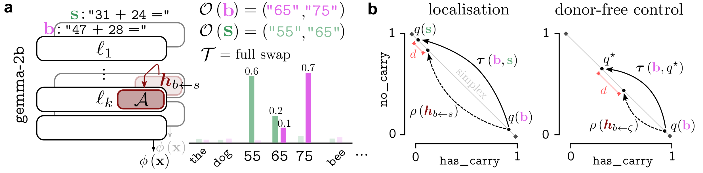
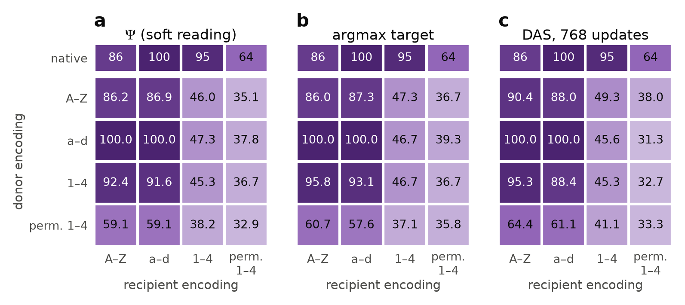

# Ψ: Programmable Semantic Interventions

[](https://arxiv.org/abs/XXXX.XXXXX)
[](https://adaptivemotorcontrollab.github.io/psi/)
[](https://github.com/AdaptiveMotorControlLab/psi/actions/workflows/tests.yml)
[](LICENSE)

Code for **Programmable Semantic Interventions: Learning Causal Carriers from
Behavioral Programs** (Paolo Muratore and Mackenzie Weygandt Mathis, EPFL).

PSI finds where a frozen language model carries a variable: a low-rank subspace
of its activations such that interchanging it between two prompts changes the
model's answer the way the variable says it should. You describe the variable
with a *semantic program*, the list of answers it can produce and which of them
an intervention should yield. The training targets are read from the frozen
model itself, on random prompt pairs, so no counterfactual dataset and no
ground-truth label is needed.



## Results

All numbers are from the paper: Gemma-2 2B, residual stream at layer 17, last
token, rank-16 subspace, on the [MIB benchmark](https://huggingface.co/mib-bench)
and on natural ARC science questions.

- **On par with supervised alignment.** At matched data and training budget on
  MIB's multiple-choice task, PSI reaches a MIB score of 90.24 ± 0.52 on random
  pairs, against 91.70 ± 0.93 for DAS trained on the benchmark's curated pairs.
  On 122 test pairs the gap is one or two pairs.
- **No labels at any stage.** Removing the correctness filter, so that no gold
  label selects prompts, sets targets or picks checkpoints, costs 0.9 points.
- **Tracks the model where it is wrong.** On 2241 natural ARC questions,
  unfiltered, the subspace makes the recipient give the donor's answer in 85.9%
  of pairs whose donor the model answers wrongly, against 72.1% for a subspace
  trained on gold labels.


- **The subspace carries the variable.** Trained with uppercase option letters
  and tested with the options relabelled, it writes the donor's *position* in
  the recipient's own symbols: from a lowercase donor into an uppercase
  recipient, it transfers the position in 100% of pairs and outputs the donor's
  own symbol in none.



- **Steering without a donor.** Because the program fixes what each coordinate
  means, a controller trained jointly with the subspace realizes 94.8% of
  held-out requests for a chosen answer, with no donor prompt.


## Installation

Python 3.11 or later and PyTorch 2.9 or later. A GPU is needed for the models
in the example configs.

```bash
git clone https://github.com/AdaptiveMotorControlLab/psi.git
cd psi
pip install -e .
```

## Quick start

```bash
psi-train configs/mcqa-qwen2.5-0.5b.yaml
```

This trains a rank-16 subspace for the position of the correct option in MIB's
multiple-choice task, on Qwen2.5-0.5B. The first run downloads the model and
the dataset, reads the frozen model on every prompt and caches its activations
under `data/`; later runs with the same model and site reuse that cache. Each
run writes to `runs/manual/<timestamp>/`:

| File | Content |
|---|---|
| `resolved.yaml` | the configuration as run |
| `metrics.csv` | training and validation metrics |
| `checkpoints/best.ckpt` | the selected checkpoint |
| `data_controls.json` | the pairing and pool settings the data module applied |

Options: `--seed N` replaces every field named `seed`, `--set path=value`
overrides any field (`--set cut.layer=12`), `--run-dir` chooses the output
directory, and `--dry-run` prepares the task and runs a single training and
validation batch without creating a run directory.

The other configs reproduce the paper's settings on Gemma-2 2B, which is a
gated model: accept its license on Hugging Face and log in
(`huggingface-cli login`) before the first run.

| Config | Setting |
|---|---|
| `configs/mcqa-qwen2.5-0.5b.yaml` | MIB multiple choice, Qwen2.5-0.5B, layer 15 |
| `configs/mcqa-gemma-2-2b.yaml` | MIB multiple choice, Gemma-2 2B, layer 17 (paper, Section 3.1) |
| `configs/arc-gemma-2-2b.yaml` | natural ARC questions, unfiltered, 768 updates (paper, Section 3.2) |

## Configuration

A config has one block per part of the method.

| Block | What it sets |
|---|---|
| `subject` | the frozen model (`model`, a Hugging Face id), `device`, `dtype` |
| `cut` | the site: `kind: residual`, `layer`, and `position`, one of the task's named token positions |
| `data` | the task and its variable, the dataset, the prompt pairing and batch sizes |
| `psi` | the semantic program's size (`test_dim`), the subspace and the objective |
| `trainer`, `checkpoint` | passed to PyTorch Lightning's `Trainer` and `ModelCheckpoint` |

Fields of `psi` you are most likely to change:

| Field | Values |
|---|---|
| `test_dim` | number of answers in the program; must equal the task's |
| `abstraction.carrier_rank` | rank of the subspace |
| `abstraction.activation_dim` | hidden size of the model at the cut |
| `target_kind` | `soft`, the model's distribution over the answers (PSI); `hard`, its argmax; `gold`, the dataset's label |
| `objective.mass_mode` | `full`, `conditional` or `reference`: how the loss treats probability mass outside the declared answers |
| `transport` | the program's rule for the answer after an interchange: `full_change` takes the donor's, `no_change` keeps the recipient's, `gated_change` and `table` choose per pair from a gate the task provides |
| `loss_weights` | `donor`, `nuisance`, `calibration` and `control` terms of the objective |

Fields of `data`: `correctness_filter: false` trains on every prompt instead of
those the model answers correctly; `donor_pairing` is `derangement` (a random
donor for each prompt) or `curated` (the dataset's own counterfactual pairs).

## Tasks

| `data.task` | Variables | Positions |
|---|---|---|
| `mcqa` | `x_order`, `o_answer` | `last_token`, `correct_symbol`, `correct_symbol_period` |
| `arc` | `x_order`, `o_answer` | `last_token`, `correct_symbol` |
| `arithmetic` | `x_carry` | `op2_last`, `last` |
| `ravel` | `a_country`, `a_continent`, `a_language` | `last_token`, `entity_last_token` |
| `ioi` | `output_position`, `output_token` | `all` |

Any dataset with the fields the multiple-choice task reads (`prompt`,
`choices.label`, `answerKey`, and one `<name>_counterfactual` column per entry
of `data.counterfactuals`) runs by changing `data.dataset`.

## Applying PSI to a new task

A task is a subclass of `TaskPreparation` (`psi/data/task.py`). It names its
variables and token positions, says how many answers the program has, and
implements three steps:

| Method | Returns |
|---|---|
| `_prepare_input(raw_split)` | tokenized prompts, what each prompt's answer is, and prompt pairs |
| `_prepare_activations(inputs, subject, observations)` | the activations at the cut |
| `_prepare_outcomes(inputs, subject, observations, pairs)` | the answer list as token ids, the model's reading of it, and the targets |

`materialize` runs these once and caches the result. `psi/data/tasks/arc.py`
is the smallest example, a new dataset on top of the multiple-choice
preparation; `psi/data/tasks/mcqa.py` is a complete one. The data types are in
`psi/data/types.py`.

`psi-train` resolves `data.task` from the built-in tasks. A task of your own
trains through the Python API:

```python
import yaml
from lightning import Trainer

from psi.data import get_datamodule
from psi.model import get_subject
from psi.psi import ProgrammableSemanticIntervention

from my_task import MyTask

config = yaml.safe_load(open("my-task.yaml"))
tokenizer, subject = get_subject(config)
task = MyTask(config["data"], tokenizer)

data = get_datamodule(config["data"], task.materialize(subject))
model = ProgrammableSemanticIntervention.from_config(config["psi"], subject)
Trainer(**config["trainer"]).fit(model, datamodule=data)
```

## Tests

```bash
pip install -e ".[dev]"
pytest
```

The tests run on CPU and download nothing.

## Citation

```bibtex
@article{muratore2026psi,
  title   = {Programmable Semantic Interventions: Learning Causal Carriers from Behavioral Programs},
  author  = {Muratore, Paolo and Mathis, Mackenzie Weygandt},
  journal = {arXiv preprint arXiv:XXXX.XXXXX},
  year    = {2026}
}
```

## License

Apache-2.0, see [LICENSE](LICENSE).
